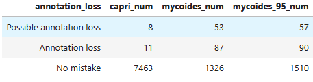
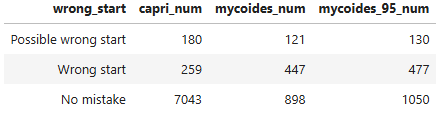
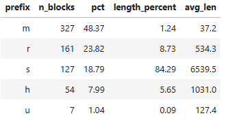
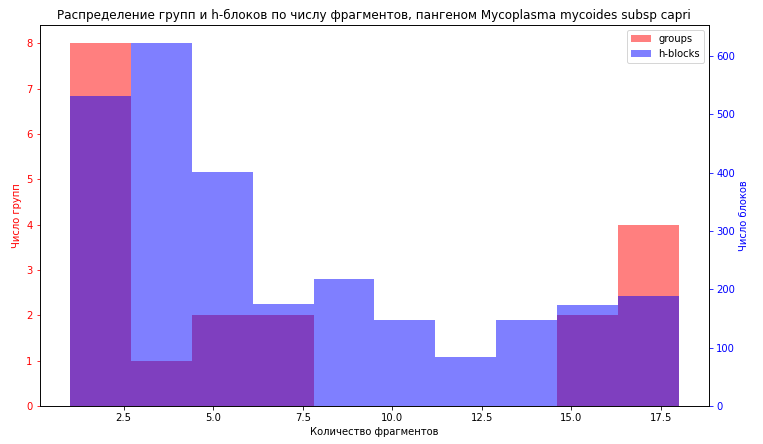

# AlAn pangenome
## Пайплайн для поиска и анализа ошибок аннотации в прокариотических геномах, используя нуклеотидный пангеном
### Цель проекта
Проанализировать типичные ошибки аннотации прокариотических геномов, а именно ошибки старта аннотации и ошибки пропуска аннотации. Исследовать возможность их исправления на основе данных нуклеотидных пангеномов &mdash; выравниваний высокосходных последовательностей.
### Основные понятия

- **Блок** &mdash; фрагмент нуклеотидного выравнивания высокого сходства.
- **S-блок** &mdash; блок, в котором представлены фрагменты всех геномов данного пангенома ровно один раз.
- **H-блок** &mdash; блок, в котором не хватает фрагментов от некоторых геномов пангенома.
- **R-блок** &mdash; блок, в котором есть несколько фрагментов с одного генома данного пангенома.
- **U-блок** &mdash; уникальный фрагмент, которому не было найдено сходств в других геномах.
- **M-блок** &mdash; минорный блок, который не соответствует минимальным требованиям к блоку.
- **Группа ортологических генов** &mdash; группа генов, лежащая в одном блоке и имеющая пересечения по позиции внутри этого блока, при этом сами гены могут лежать на разных последовательностях.

### Ключевые результаты
Сравнение количества потенциальных ошибок аннотации в группах ортологических генов пангеномов *Mycoplasma mycoides* subsp. *mycoides* и *Mycoplasma mycoides* subsp. *capri* (построенных как с обычным порогом сходства в 90%, так и в 95%): <br>
 <br>
 <br>
Количество проблемных мест с аннотацией заметно выше в пангеноме subsp. *mycoides*, чем в subsp. *capri*, например, количество пропусков аннотации составляет 85 у *mycoides* против 18 у *capri*. <br>
Данные по блокам в пангеноме *Mycoplasma mycoides* subsp. *mycoides*: <br>
 <br>
Видно, что пангеном subsp. *mycoides* имеет довольно высокое сходство: ядро пангенома (s-блоки) составляют 84% суммаарной длины блоков.<br>
Гистограмма распределения h-блоков и в пангеноме *Mycoplasma mycoides* subsp. *capri*: <br>
 <br>
Распределение h-блоков в пангеноме subsp. *capri* довольно типичное: большой пик на малом числе пропусков, небольшой пик на большом числе пропусков.
### Схема пайплайна
Программа `run_pipeline.py` запускает последовательность программ. Сначала `seq_auto.py` строит по входной таблице с идентификаторами сборок файл `genomes.tsv`, который является входным файлом для программы NPG_explorer, которая строит нуклеотидный пангеном. Затем программа `auto_npge.py` запускает [NPG_explorer](https://github.com/npge/npge). После чего `alan.py` строит таблицы с ортологическими группами генов на основе результатов работы NPG_explorer. Далее отдельно в jupyter-notebook анализируются результаты и строятся итоговые таблицы и графики. <br>
Кратко: таблица геномов -> `seq_auto.py` -> `genomes.tsv` -> `auto_npge.py` (NPG_explorer) -> `alan.py` -> jupyter-notebook
### Структура репозитория
```
alan_pangenome/
├── data/                  # входные таблицы сборок для построения пангеномов
├── notebooks/
│   └── Analyse_result.ipynb   # анализ результатов, итоговые таблицы и графики
├── results/
│   ├── figures/           # картинки для README
│   ├── mycoplasma_mycoides_subsp_capri/
│   |   ├── alan_result/   # таблицы групп ортологических генов
│   |   └── trees/         # деревья
│   ├── mycoplasma_mycoides_subsp_mycoides/
│   |   ├── alan_result/   # таблицы групп ортологических генов
│   |   └── trees/         # деревья
│   └── mycoplasma_mycoides_subsp_mycoides_95/ # тот же пангеном mycoides, но построенный с порогом в 95% сходства
│       ├── alan_result/   # таблицы групп ортологических генов
│       └── trees/         # деревья
├── src/                   # скрипты пайплайна
│   ├── run_pipeline.py    # запускает всю цепочку
│   ├── seq_auto.py        # строит genomes.tsv по таблице сборок
│   ├── auto_npge.py       # запускает NPG_explorer
│   └── alan.py            # строит таблицы групп генов
├── .gitignore
└── README.md
```
### Установка и запуск
Для работы пайплайна требуется python версии не ниже 3.10 с библиотекой pandas, biopython, openpyxl, а также установленная программа NPG_explorer. <br>
Запуск программы `run_pipeline.py`: `python src/run_pipeline.py [имя рабочей директории]`. <br>
Остальные параметры:

| Параметр | Описание | Значение по умолчанию |
|---|---|---|
| `-h, --help` | показать окно справки | |
| `-t TABLE, --table TABLE` | Путь к входной таблице сборок (.tsv или .csv) для seq_auto (обязателен, если запускается seq_auto) | |
| `-s, --only-seq-auto` | Запустить только seq_auto | |
| `-n, --only-npge` | Запустить только auto_npge | |
| `-a, --only-alan` | Запустить только alan | |
| `-c, --csv` | alan: сохранять таблицы в csv вместо Excel | |
|`-i, --identity` | Задать минимальное требование к сходству внутри блока (доля) | `0.9` |
|`-l, --length` | Задать минимальное требование к длине блока (пары нуклеотидов) | `100` |
| `-e EMAIL, --email EMAIL` | Email для Entrez.email (обязателен для запросов к NCBI) | |
| `--api-key API_KEY` | NCBI API-ключ (опционально, увеличивает лимит запросов) | |
| `--assembly-col ASSEMBLY_COL` | Название столбца с accession сборки | `Assembly Accession` |
| `--linkname LINKNAME` | Имя elink-связи между assembly и nucleotide | `assembly_nuccore_insdc` |
| `--max-retries MAX_RETRIES` | Максимальное число повторных попыток Entrez-запроса | `5` |
| `--base-delay BASE_DELAY` | Базовая задержка перед повтором запроса, секунды | `2` |
| `--request-delay REQUEST_DELAY` | Задержка между запросами к NCBI, секунды | `0.34` |

Пример запуска: `python src/run_pipeline.py mycoplasma_mycoides_subsp_mycoides -t data/mycoplasma_mycoides_subsp_mycoides.tsv -e email@example.com`
### Данные
Последовательности геномов взяты с сайта NCBI (Genbank). Промежуточные данные и прочие результаты можно воспроизвести пайплайном.
### Статус и планы
На данный момент полностью реализован автоматизированный пайплайн для построения пангеномов и его анализа. Дальнейшие планы заключаются в большем уточнении результата, добавлении нового анализа, а также рассмотрении крупных геномных событий.